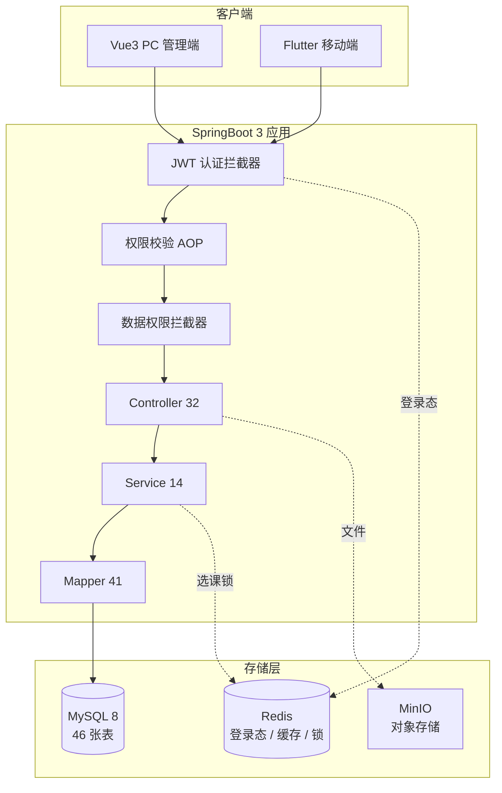
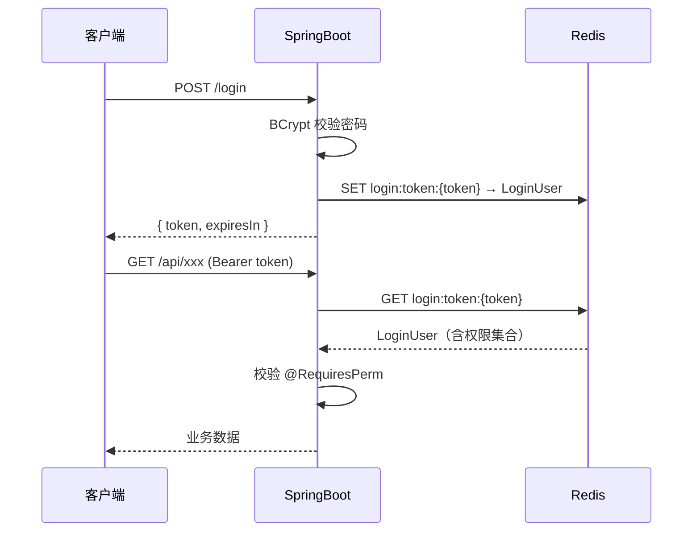

<div align="center">

# 🎓 高校综合管理系统 · 后端

**SpringBoot 3 + MyBatis-Plus + MySQL 8 + Redis**

一套覆盖 **教务 / 学工 / 后勤 / 第二课堂 / 课堂考勤** 的高校业务后端

[](https://spring.io/projects/spring-boot)
[](https://baomidou.com/)
[](https://www.mysql.com/)
[](https://redis.io/)
[](https://openjdk.org/)
[](LICENSE)

[功能模块](#-功能模块) · [系统架构](#-系统架构) · [快速开始](#-快速开始) · [权限体系](#-权限体系) · [接口文档](#-接口文档) · [数据库](#-数据库设计)

</div>

---

## 📖 项目简介

面向高校的综合性业务后端，采用 **单体 B/S 架构**，一套服务同时支撑 PC 管理端与移动端 App。

核心特点：

- 🔐 **RBAC + 四档数据权限** —— 功能权限精确到按钮，数据权限按院系 / 班级 / 本人隔离
- ⚡ **Redis 分布式锁** —— 选课高并发防超员
- 🧩 **冲突检测** —— 排课的班级 / 教师 / 教室三重校验
- 📋 **状态机驱动** —— 成绩、请假、助学金、报修全流程状态流转
- 📱 **移动端友好** —— 同一套接口服务 Web 与 App

---

## ✨ 功能模块

<table>
<tr>
<td width="50%" valign="top">

### 📚 教务管理

- 课程库 / 教室管理
- **智能排课**（三重冲突检测）
- 课表查询（学生 / 教师 / 班级三视角）
- **选课**（Redis 锁 + 原子扣减）
- **成绩管理**（5 状态机）
- 考试安排 / 监考
- 培养方案
- 调课申请审批
- 教学评教

</td>
<td width="50%" valign="top">

### 🎒 学工管理

- 学生档案
- **请假申请**（多级审批）
- **助学金**（三级审批 + 公示）
- 奖惩记录
- **学生关爱平台**
  - 关爱对象 / 风险分级
  - 关爱记录时间轴
- **宿舍归寝**
  - 正常 / 晚归 / 未归 / 请假
  - 支持门禁设备对接

</td>
</tr>
<tr>
<td width="50%" valign="top">

### 🏢 后勤管理

- 宿舍楼 / 房间
- 宿舍分配 / 退宿
- **报修工单**
  - 待派单 → 维修中 → 已完成 → 验收评分
- 场地预约
- 教室借用审批

</td>
<td width="50%" valign="top">

### 🏆 第二课堂

- 活动发布 / 报名
- **现场扫码签到**
- 活动组织者签到管理
- **学分统计**
  - 按团中央「第二课堂成绩单」制度
  - 七大模块 / 五号文标准

</td>
</tr>
<tr>
<td width="50%" valign="top">

### ✅ 课堂考勤

- 教师发起点名
- 6 位签到码
- **五种状态**自动判定
  - 正常 / 迟到 / 早退 / 缺勤 / 请假
- 教师查看缺勤名单
- 教务出勤统计

</td>
<td width="50%" valign="top">

### 📊 统计报表

- 学生分布
- 成绩分布
- 资助统计
- 报修统计
- 数据大屏（总览指标）

</td>
</tr>
</table>

---

## 🏗 系统架构



### 请求处理链路

```
HTTP 请求
   ↓
AuthInterceptor      解析 JWT → 校验 Redis 登录态 → 注入 UserContext
   ↓
PermissionAspect     校验 @RequiresPerm 权限标识
   ↓
DataPermissionHandler 按 data_scope 自动拼接 SQL 条件
   ↓
Controller → Service → Mapper
   ↓
Result<T> 统一响应
```

---

## 📊 项目规模

<table>
<tr>
<td align="center" width="25%">

### 190
**Java 文件**

</td>
<td align="center" width="25%">

### 203
**REST 接口**

</td>
<td align="center" width="25%">

### 46
**数据表**

</td>
<td align="center" width="25%">

### 32
**业务模块**

</td>
</tr>
</table>

---

## 🚀 快速开始

### 环境要求

```text
JDK     17+
Maven   3.8+
MySQL   8.0
Redis   7.x
```

### 1️⃣ 初始化数据库

```bash
mysql -uroot -p -e "CREATE DATABASE campus_ms DEFAULT CHARSET utf8mb4 COLLATE utf8mb4_general_ci;"

mysql -uroot -p campus_ms < docs/sql/01_schema.sql
mysql -uroot -p campus_ms < docs/sql/02_init_data.sql
mysql -uroot -p campus_ms < docs/sql/03_index_optimize.sql
mysql -uroot -p campus_ms < docs/sql/04_care_dorm_ec.sql
mysql -uroot -p campus_ms < docs/sql/05_care_dorm_ec_fix.sql
```

> 💡 需要测试数据可额外执行 `06_test_data.sql`（44 学生 / 18 教师 / 397 成绩）

### 2️⃣ 修改配置

`src/main/resources/application-dev.yml`

```yaml
spring:
  datasource:
    url: jdbc:mysql://localhost:3306/campus_ms?useUnicode=true&characterEncoding=utf8&serverTimezone=Asia/Shanghai
    username: root
    password: 你的密码
  data:
    redis:
      host: localhost
      port: 6379
```

### 3️⃣ 启动

```bash
mvn clean package -DskipTests
java -jar target/campus-ms.jar
```

### 4️⃣ 访问

| 地址 | 说明 |
|---|---|
| `http://localhost:8080/api` | 服务根路径 |
| `http://localhost:8080/api/doc.html` | Knife4j 接口文档 |
| `http://localhost:8080/api/v3/api-docs` | OpenAPI JSON |

---

## 🔑 默认账号

密码统一 `123456`

<table>
<tr><th>账号</th><th>角色</th><th>数据范围</th><th>说明</th></tr>
<tr><td><code>admin</code></td><td>超级管理员</td><td>全部</td><td>151 个菜单权限</td></tr>
<tr><td><code>school</code></td><td>校级管理员</td><td>全部</td><td>57 个权限</td></tr>
<tr><td><code>edu</code></td><td>教务管理员</td><td>全部</td><td>59 个权限</td></tr>
<tr><td><code>study</code></td><td>学工管理员</td><td>全部</td><td>33 个权限</td></tr>
<tr><td><code>logistics</code></td><td>后勤管理员</td><td>全部</td><td>25 个权限</td></tr>
<tr><td><code>c_wang</code></td><td>辅导员</td><td>本班</td><td>31 个权限</td></tr>
<tr><td><code>t_zhang</code></td><td>教师</td><td>本人</td><td>授课 / 成绩 / 点名</td></tr>
<tr><td><code>stu_001</code></td><td>学生</td><td>本人</td><td>课表 / 选课 / 成绩</td></tr>
</table>

> ⚠️ 权限变更后需重新登录（权限集合缓存在 Redis 的 `LoginUser`）

---

## 🔐 权限体系

### 功能权限（注解式）

```java
@Operation(summary = "新增课程")
@RequiresPerm("edu:course:add")
@PostMapping("/edu/course")
public Result<Void> add(@RequestBody Course course) {
    courseService.add(course);
    return Result.ok("新增成功", null);
}
```

权限标识规则：`模块:资源:操作`

### 数据权限（四档隔离）

| 档位 | 范围 | 实现 |
|:---:|---|---|
| 1 | 全部数据 | 不加条件 |
| 2 | 本院系 | `AND dept_id = ?` |
| 3 | 本班 | `AND clazz_id = ?` |
| 4 | 仅本人 | `AND user_id = ?` |

由 `@DataScope` + MyBatis-Plus `DataPermissionInterceptor` 自动拼接。

### 登录态



---

## 🧠 核心设计

### 排课冲突检测

```java
// 时间重叠判定：新排课的 start ≤ 已有 end 且 end ≥ 已有 start
if (count(Wrappers.<Schedule>lambdaQuery()
        .eq(Schedule::getClazzId, dto.getClazzId())
        .le(Schedule::getSectionStart, dto.getSectionEnd())
        .ge(Schedule::getSectionEnd, dto.getSectionStart())
        .eq(Schedule::getDayOfWeek, dto.getDayOfWeek())) > 0) {
    throw new BizException("该班级在此时间段已有排课");
}
// 教师、教室同理
```

### 选课防超员

```java
// SQL 原子扣减，天然并发安全
int rows = scheduleMapper.update(null, Wrappers.<Schedule>lambdaUpdate()
        .setSql("current_num = current_num + 1")
        .eq(Schedule::getId, scheduleId)
        .apply("current_num < max_num"));   // ← 关键

if (rows == 0) {
    throw new BizException("报名人数已满");
}
```

配合 Redis 锁 `lock:elect:{scheduleId}` 防止重复提交。

### 成绩状态机


绩点：`(score - 50) / 10`，60 分以下为 0

### 课堂签到五态

| 状态 | 判定 |
|---|---|
| 🟢 正常 | 签到码开放后 2 分钟内签到 |
| 🟡 迟到 | 超过 2 分钟签到 |
| 🟠 早退 | 教师手动标记 |
| 🔵 请假 | 当天有 `status=3` 的请假单 |
| 🔴 缺勤 | 未签到且无请假（**实时计算，不落库**） |

### 第二课堂学分

依据《高校共青团"第二课堂成绩单"制度实施办法》（**中青联发〔2018〕5 号**）

| 模块 | 最低学分 | 映射活动类型 |
|---|---:|:---|
| 思想成长 | 1.0 | 讲座报告 |
| 实践实习 | 1.0 | 社会实践 |
| 志愿公益 | 1.0 | 志愿服务 |
| 创新创业 | 1.0 | 学科竞赛 |
| 文体活动 | 0.5 | 文体活动 |
| 工作履历 | 0.5 | 社团活动 |
| 技能特长 | 0.5 | 其他 |
| **合计** | **5.5** | |

---

## 📡 接口文档

启动后访问 Knife4j：`http://localhost:8080/api/doc.html`

完整接口清单见 [docs/API.md](docs/API.md)（**203 个接口 / 32 个分组**）

<details>
<summary><b>📂 点击展开模块列表</b></summary>

| 模块 | 接口数 | 说明 |
|---|---:|---|
| 认证 | 5 | 登录 / 登出 / 用户信息 / 菜单 |
| 系统-用户 | 12 | CRUD / 状态 / 重置密码 / 分配角色 |
| 系统-角色 | 7 | CRUD / 分配菜单 |
| 系统-菜单 | 6 | 树查询 / CRUD |
| 系统-院系 | 5 | 树查询 / CRUD |
| 系统-专业 | 5 | 分页 / CRUD |
| 系统-班级 | 5 | 分页 / CRUD |
| 系统-学期 | 6 | 列表 / 当前学期 / CRUD |
| 系统-字典 | 8 | 类型 / 数据 |
| 系统-日志 | 2 | 操作日志 / 登录日志 |
| 教务-课程 | 6 | 分页 / 列表 / CRUD |
| 教务-教室 | 5 | 分页 / 列表 / CRUD |
| 教务-排课 | 4 | 分页 / CRUD（含冲突检测） |
| 教务-课表 | 3 | 学生 / 教师 / 班级 |
| 教务-选课 | 5 | 可选 / 选课 / 退课 / 我的 |
| 教务-成绩 | 7 | 分页 / 名单 / 批量 / 提交 / 锁定 |
| 教务-考试 | 6 | CRUD / 监考 |
| 教务-培养方案 | 3 | 分页 / 新增 / 删除 |
| 教务-调课 | 3 | 分页 / 提交 / 审批 |
| 教务-评教 | 3 | 分页 / 统计 / 提交 |
| 学工-学生档案 | 5 | 分页 / 详情 / CRUD |
| 学工-请假 | 4 | 分页 / 我的 / 提交 / 审批 |
| 学工-助学金 | 5 | 分页 / 我的 / 提交 / 审批 / 公示 |
| 学工-奖惩 | 4 | 分页 / CRUD |
| 学工-关爱 | 8 | 对象 CRUD / 记录 CRUD |
| 学工-归寝 | 6 | 分页 / 登记 / 统计 / 预警 |
| 后勤-宿舍 | 12 | 楼栋 / 房间 / 分配 |
| 后勤-报修 | 5 | 分页 / 提交 / 派单 / 完成 / 确认 |
| 后勤-场地 | 3 | 分页 / 提交 / 审批 |
| 二课-活动 | 8 | CRUD / 发布 / 报名 / 名单 |
| 二课-学分 | 1 | 七模块统计 |
| 二课-签到 | 7 | 开签到 / 签到 / 名单 / 批量确认 |
| 考勤 | 10 | 发起 / 签到 / 五态 / 统计 |
| 公告 | 6 | CRUD / 发布 / 撤回 |
| 报表 | 5 | 学生 / 成绩 / 资助 / 报修 / 大屏 |

</details>

---

## 🗄 数据库设计

**46 张表**，完整字段说明见 [docs/DATABASE.md](docs/DATABASE.md)

<details>
<summary><b>📂 点击展开表分组</b></summary>

| 分组 | 表 |
|---|---|
| **系统** | `sys_user` `sys_role` `sys_menu` `sys_role_menu` `sys_user_role` `sys_dept` `sys_oper_log` `sys_login_log` `sys_dict_type` `sys_dict_data` |
| **基础** | `major` `clazz` `student` `teacher` |
| **教务** | `course` `classroom` `schedule` `semester` `score` `elect_course` `exam` `exam_invigilator` `evaluation` `course_plan` `adjust_apply` |
| **学工** | `leave_apply` `aid_apply` `award_punish` `care_target` `care_record` |
| **后勤** | `dorm_building` `dorm_room` `dorm_assignment` `dorm_checkin` `repair_order` `room_booking` |
| **二课** | `ec_activity` `ec_enroll` |
| **考勤** | `attend_session` `attend_record` |
| **资讯** | `notice` |

</details>

**索引优化**：14 个复合索引 + 9 个冗余单列删除，每表索引数 ≤ 6

---

## 📁 目录结构

```
backend/
├── docs/
│   ├── API.md              203 个接口清单
│   ├── DATABASE.md         46 张表结构
│   └── sql/                建库脚本
├── src/main/java/com/campus/
│   ├── common/             通用返回、异常、JWT、Redis 工具
│   ├── config/             MyBatis-Plus、Redis、CORS、密码编码
│   ├── security/           拦截器、权限注解、数据权限切面
│   ├── entity/             42 个实体
│   ├── mapper/             41 个 Mapper
│   ├── service/            14 个业务服务
│   ├── controller/         32 个 REST 控制器
│   ├── dto/                请求对象
│   └── vo/                 响应对象
├── src/main/resources/
│   ├── application.yml
│   └── application-dev.yml
└── pom.xml
```

---

## 🛠 开发指南

### 新增业务模块

1. **建表** → `docs/sql/` 下加 SQL
2. **Entity** → 继承 `BaseEntity`（自带 5 个公共字段）
3. **Mapper** → `extends BaseMapper<T>` + `@Mapper`
4. **Service** → 接口 + Impl
5. **Controller** → 加 `@RequiresPerm`
6. **菜单** → 插入 `sys_menu` + 授权 `sys_role_menu`

### 分页查询注意

```java
// ⚠️ Result<PageResult<T>> 嵌套时 Java 无法推断 T，需显式指定
Page<Course> result = courseMapper.selectPage(page, w);
return Result.ok(PageResult.<Course>of(result));
```

### 逻辑删除

所有表使用 `is_deleted` 字段，MyBatis-Plus 自动处理：

```yaml
mybatis-plus:
  global-config:
    db-config:
      logic-delete-field: isDeleted
      logic-delete-value: 1
      logic-not-delete-value: 0
```

---

## 🤝 贡献

欢迎提 Issue 和 PR。

- 🐛 [报告 Bug](../../issues/new?template=bug_report.md)
- ✨ [功能建议](../../issues/new?template=feature_request.md)
- 📝 提交前请运行 `mvn clean test`

---

## 📄 License

本项目基于 [MIT License](LICENSE) 开源。

---

<div align="center">

**如果这个项目对你有帮助，请给个 ⭐ Star**

Made with ☕ by [TTFCJ](https://github.com/TTFCJ)

</div>
